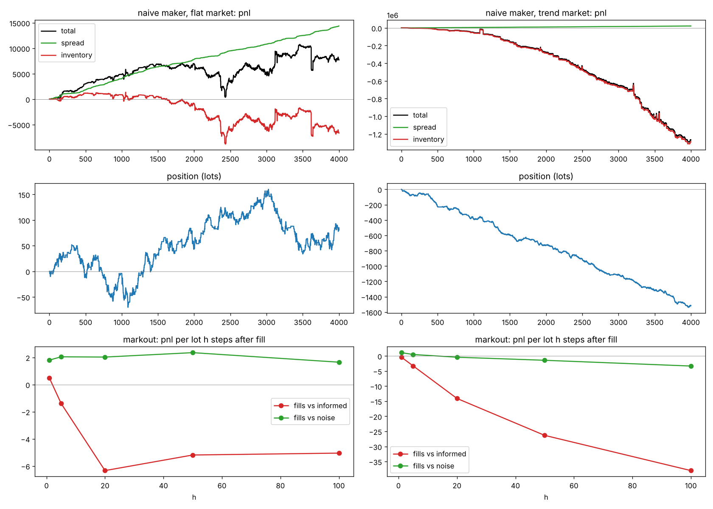
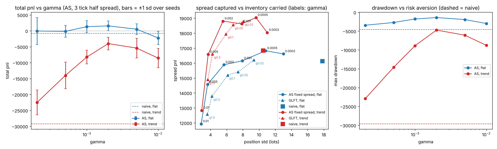
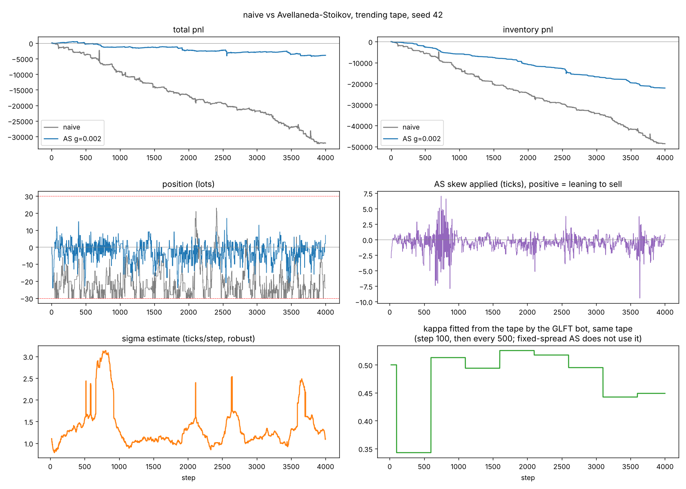
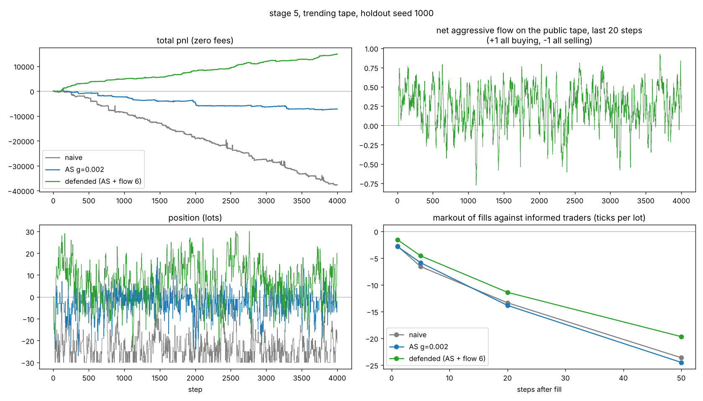

# lob-sim

A limit order book matching engine, an agent based market simulator and a few
market making bots, all written from scratch in Python. The last stage takes
the same bots to real Binance order book data using hftbacktest.

The question I was working on: how much of a market maker's spread survives
inventory risk and adverse selection? And what does it take to keep it?

## TL;DR

- In the simulator, Avellaneda-Stoikov inventory skew beats a naive fixed
  spread maker by a wide margin whenever the market trends, up or down, under
  every stress I tried. On a flat market it mainly cuts risk. The PnL gain
  there is small and fragile.
- Leaning the quotes on recent trade flow (stage 5) looked great in the sim.
  On 30 holdout seeds it beat plain AS in all 12 test conditions.
- On 12 real days of Binance SOLUSDT it fell apart. Order flow predicts about
  one second ahead and explains around 0.1% of that move. The flow bot was
  significantly worse than plain AS on every holdout day and no bot had a
  positive edge even before fees. My simulator made order flow far more
  predictive than a real market is.
- At retail fees none of the tight spread bots make money, sim or real.

## Running it

```
pip install -e ".[dev]"        # stage 6 needs Python 3.11+ and pip install -e ".[dev,real]"
pytest                         # 153 tests, about a minute
python run_all.py              # or just this: install, tests, charts, quick real data check
```

Individual experiments:

```
python scripts/bench.py         # engine throughput
python scripts/run_market.py    # simulator chart (add "trend" for a drifting tape)
python scripts/run_naive.py     # naive maker: pnl split, position, markouts
python scripts/run_as.py        # naive vs AS on one tape (add "trend")
python scripts/evaluate.py      # 20 seeds x 11 configs
python scripts/sweep_gamma.py   # AS and GLFT gamma sweep
python scripts/sweep_spread.py  # naive half spread sweep
python scripts/paired.py        # paired t tests, naive vs AS
python scripts/robustness.py    # holdout seeds, drift, fat tails, vol regimes, latency, fees (~25 min)
python scripts/sim_checks.py    # stylized facts, edge vs true price, self impact etc
python scripts/stage5.py        # stage 5 holdout run ("ablate" for the training ablation)
python scripts/run_defended.py  # naive vs AS vs defended on one tape
```

The sweeps take a few minutes each.

## Layout

```
lobsim/orderbook.py   matching engine
lobsim/market.py      simulator + the gateway a bot talks to
lobsim/strategy.py    blotter, naive / AS / GLFT / defended makers
lobsim/analytics.py   markouts, drawdown, multi seed and paired evaluation
stage6/               real data: download, convert, flow check, bots on hftbacktest
scripts/              the experiments behind every number below
tests/                153 tests
docs/                 charts
```

## Stage 1: matching engine

Price-time priority, integer ticks and lots (no floats anywhere in matching).

Each side of the book is a sorted map of price to level. A level is an
intrusive doubly linked list, so every order knows its neighbours and a cancel
is an O(1) unlink. Only removing an emptied level costs O(log levels). Lookup
by id and best price are both O(1).

It supports LIMIT, MARKET, IOC, FOK, POST_ONLY, STOP and STOP_LIMIT through a
single `submit()`. Stops wait off book until the last trade touches the
trigger and they can cascade. Modify works like on an exchange: reducing size
keeps your place in the queue, anything else is cancel and re-add.

Self trade prevention by participant id (cancel newest, cancel oldest or
both). FOK stays all or nothing even when STP kicks in. Every state
change is a sequenced event, so `OrderBook.replay(events)` rebuilds the book
at any point. A property based test checks replay against the live book.

There are also the usual signals a strategy wants: mid, spread, microprice,
N level imbalance, queue position, volume at or better, VWAP to fill a size.

Speed is about 110k ops/sec single threaded in CPython. I used the linked list
layout so the hot path could be ported to C++ without redesigning it.

## Stage 2: simulator

- A hidden true price follows a random walk with drift and Poisson jumps.
  Optionally Student-t steps (`tail_df`) and a two state volatility regime
  (`vol_regime`), both scaled so overall volatility stays the same and only
  the shape changes.
- Noise traders post limits near the touch, send market orders and cancel at
  random. Their market orders are IOC limits 16 ticks through the mid (a
  price collar, like a real venue has). 70% of them anchor on the visible mid,
  30% on a noisy guess of fair value.
- Informed traders see the true price and sweep whichever side has gone
  stale. They also post at fair value when a side of the book is empty.
- One slot for a bot. It gets `on_tick(book, t)`, `on_trade(trade, maker_pid,
  taker_pid, pre_mid)` and a gateway with the book, `send()`, `cancel()`,
  latency and a clock. `pre_mid` is the mid the aggressor saw, which is what
  edge gets measured against. Fills are handed over between book operations,
  not from inside the matcher, so a bot can safely send orders from
  `on_trade`.
- The gateway doesn't expose the market, but it's a convention and not a
  real sandbox. Python can always dig through closures and resting orders
  carry participant ids a real exchange wouldn't show. None of my bots touch
  either.
- Order and cancel latency in steps.
- Every trade records both sides, so adverse selection can be measured
  directly. Everything is seeded, so two bots can be compared on the exact
  same tape.

## Stage 3: the naive maker

`Blotter` splits PnL like a desk would. Spread PnL is the edge captured
against mid at each fill. Inventory PnL is whatever the open position did
afterwards. Fees are separate (maker rebates supported). `liquidate(book)`
also gives the PnL if you flattened the leftover position by crossing the
book and paying the taker fee, instead of pretending you can close at mid.

`NaiveMaker` quotes a fixed half spread around mid. Options are a hard
position cap (quote size gets cut to the room left) and requoting only when
the price changes so queue priority is kept. The cap counts resting and
in-flight orders so it holds under latency.

All runs below: 4000 steps, seeds 100 to 119, cap 30 unless stated, size 5,
mean ± std across seeds.

| config | total pnl | spread pnl | inventory pnl | max pos | drawdown |
|---|---|---|---|---|---|
| requote every step, no cap | -9,155 ± 20,610 | 16,727 | -25,882 | 288 | -25,352 |
| requote on change, no cap | -8,286 ± 22,358 | 16,878 | -25,163 | 258 | -26,832 |
| requote on change, cap 30 | -790 ± 4,220 | 16,141 | -16,931 | 30 | -4,580 |
| cap 30, latency 3 | -1,881 ± 2,601 | 11,819 | -13,700 | 30 | -4,576 |
| cap 30, maker rebate 0.5bp | 1,955 ± 4,170 | 16,141 | -16,931 | 30 | -3,828 |
| cap 30, trend 0.4 tick/step | -29,232 ± 3,379 | 16,848 | -46,079 | 30 | -29,631 |

The bot books about 16k of spread every run and loses more than that on
inventory. The cap cuts variance 5x but doesn't fix the sign. Three steps of
latency eat about a quarter of the spread PnL.

Markouts (seed 42, flat, PnL per lot h steps after a fill):

| counterparty | h=1 | h=5 | h=20 | h=50 | h=100 |
|---|---|---|---|---|---|
| noise | +1.8 | +2.0 | +2.0 | +2.4 | +1.6 |
| informed | +0.5 | -1.4 | -6.3 | -5.2 | -5.1 |

Fills against noise keep their edge. Fills against informed traders (12.5% of
fills) go negative within 5 steps and stay there. In a trend the informed
markout gets to -38 at h=100.



I never tuned the half spread of 3, so `sweep_spread.py` checks it:

| half spread | flat total | fills | trend total | fills |
|---|---|---|---|---|
| 1 | -6,695 ± 3,246 | 3,553 | -36,238 ± 4,005 | 3,534 |
| 3 | -790 ± 4,220 | 1,700 | -29,232 ± 3,379 | 1,758 |
| 5 | 1,369 ± 2,901 | 792 | -32,318 ± 6,278 | 882 |
| 8 | 4,349 ± 2,440 | 387 | -34,391 ± 6,266 | 464 |
| 12 | 5,601 ± 3,740 | 262 | -31,540 ± 5,497 | 272 |
| 20 | 4,441 ± 2,696 | 87 | -32,327 ± 4,237 | 87 |
| 50 | -443 ± 2,680 | 25 | -311 ± 18,143 | 34 |

Flat market: wider is better up to around 8 to 12 (fewer fills, less adverse
selection). Trending market: every width loses about 30k. At 50 the bot
barely trades so the trend number is basically a coin flip (±18k).

## Stage 4: inventory skew

`InventoryMaker` is Avellaneda-Stoikov with time to horizon held constant,
since the sim has no session end. Reservation price is
`mid - q·γ·σ²·horizon` and quotes go at `reservation ± half spread`, so when
long both quotes move down and the ask gets hit first. Three spread modes:

- `fixed`: same spread as the naive bot, only the skew is different
- `as`: the full AS half spread `γ·σ²·horizon/2 + (1/γ)·ln(1+γ/κ)`
- `glft`: Guéant-Lehalle-Fernandez-Tapia, the infinite horizon version that
  hftbacktest's examples use. Spread and skew both come from fitted A and κ.

σ is a winsorised rolling std of mid changes. A plain std blows up when a
side of the book empties for a step and a MAD quantises on half ticks. κ and
A are fitted by least squares on the public trade tape (first at step 100,
then every 500 steps over a 2000 step window). Everything comes from the book.
The skew is clamped and quotes are clipped so post only orders never cross.

`horizon=50` steps throughout.

| | flat: total | pos std | drawdown | trend: total | pos std | drawdown |
|---|---|---|---|---|---|---|
| naive | -790 ± 4,220 | 17.8 | -4,580 | -29,232 ± 3,379 | 10.5 | -29,631 |
| AS γ=0.001 | 1,312 ± 1,842 | 7.9 | -1,770 | -8,227 ± 2,154 | 7.9 | -8,871 |
| AS γ=0.002 | 1,556 ± 1,512 | 5.7 | -1,401 | -4,016 ± 1,996 | 5.5 | -4,721 |
| AS γ=0.005 | 522 ± 1,694 | 3.6 | -1,924 | -5,419 ± 3,063 | 3.7 | -6,081 |
| AS γ=0.01 | -2,234 ± 2,077 | 2.8 | -2,978 | -8,557 ± 3,076 | 2.9 | -8,761 |
| GLFT γ=0.1 | 1,102 ± 1,860 | 6.1 | -1,586 | -5,772 ± 2,338 | 5.9 | -6,222 |

Mean ± std across seeds hides the fact that both bots saw the same tape, so
the real comparison is paired (`scripts/paired.py`). AS γ=0.002 minus naive,
20 seeds:

| | hs 3, flat | hs 3, trend | hs 8, flat | hs 8, trend |
|---|---|---|---|---|
| total pnl | +2,346, t = 2.0, 10/20 | +25,216, t = 25.3, 20/20 | -2,054, t = -2.7, 4/20 | +32,555, t = 20.8, 20/20 |
| drawdown | t = 3.5, 18/20 | t = 25.3, 20/20 | t = 3.5, 16/20 | t = 20.6, 20/20 |
| position std | t = -50, 20/20 | t = -14, 20/20 | t = -13, 20/20 | t = -7, 18/20 |
| time at cap | 7.6% to 0%, 20/20 | 16.4% to 0%, 20/20 | t = -5.1, 20/20 | t = -16, 20/20 |



My read of it:

- In a trend the skew wins at any spread: +25k to +33k on all 20 seeds,
  t above 20. Widening the naive spread doesn't save it.
- On a flat tape it's mostly risk control. The PnL gain at hs 3 is marginal
  (t = 2.0) and against naive at hs 8 AS even looks worse (t = -2.7). But γ
  and that 8 were picked on these same seeds. On 30 fresh seeds (see
  pitfalls below) the first gets stronger (t = 3.9) and the second goes away
  (t = -1.4). Lower drawdown, about a third of the position variance and
  never hitting the cap hold on every tape.
- Position std and drawdown fall with γ, way outside noise. PnL across γ is
  murkier. On flat, 0.002 beats 0.005 (t = 3.0) and ties 0.001 (t = 0.5). On
  trend, 0.002 beats 0.001 (t = 6.5) and is close to 0.005 (t = 1.7). So I
  wouldn't call 0.002 optimal, just never clearly beaten.
- At γ=0.01 the skew gives away most of the spread to dump inventory and
  total goes negative.
- GLFT, with no hand picked spread at all, ends up quoting about 2 to 2.5
  ticks and trades ~45% more. Against fixed spread AS it ties on flat
  (t = -0.7) and trails by ~1.8k in a trend (t = -2.6).



One seed, trending tape: naive drifts to the cap and bleeds while AS stays
near flat. Bottom panels are σ as the AS bot sees it and κ as fitted by a
GLFT bot on the same tape.

## Stage 5: adverse selection defences

`DefensiveMaker` is AS (γ = 0.002, hs 3, cap 30) plus four optional
defences. They only use what a real maker can see: the book, the public tape
(price, size, aggressor side) and its own fills. No counterparty ids (there's
a test for that).

- requote tolerance: leave a resting quote alone if it's up to k ticks
  *behind* target. Never keep one that ended up more aggressive than target,
  since that's the stale quote informed flow picks off.
- book imbalance: lean fair value on top of book imbalance, with the bot's
  own quotes removed so it doesn't chase itself.
- trade flow: lean fair value on net aggressive volume over the last 20
  steps, (buys - sells) / total.
- toxicity: mark out the bot's own fills 10 steps later, keep a moving
  average per side and back off the side that keeps losing.

I tried each one alone and combined on training seeds 100 to 109
(`stage5.py ablate`). Before looking at any holdout run I fixed the rule:
pick whatever maximises the worst t across flat, flat with latency 3 and
trend. That picked trade flow alone with coefficient 6.

| defence | flat | flat, latency 3 | trend | verdict |
|---|---|---|---|---|
| requote tol 1 | +1.0k, t 1.4 | +2.2k, t 2.5 | -1.3k, t -2.4 | helps with latency, hurts in trends |
| imbalance 1 | +1.0k, t 1.5 | +2.3k, t 2.5 | 0, t 0.0 | weak, harmful at coefficient 4 |
| trade flow 6 | +4.7k, t 6.8 | +4.6k, t 6.0 | +13.8k, t 13.9 | chosen |
| toxicity 1 | +1.1k, t 2.7 | +1.0k, t 1.0 | +10.6k, t 17.6 | trend gain with *worse* fills (edge t -2.5), it's a directional bet, rejected |
| all four | +2.9k, t 3.9 | +4.1k, t 7.7 | +16.2k, t 11.2 | combining made flat worse |

Then that one config, unchanged, on holdout seeds 1000 to 1029. Defended
minus AS, PnL after liquidation, no fees:

| tape | pnl gain | t | better | from better fills | inventory | pos std change |
|---|---|---|---|---|---|---|
| flat | +4,099 | 7.3 | 27/30 | 3,746 (91%) | 353 | +4.7 lots |
| flat, fat tails | +4,050 | 7.7 | 28/30 | 4,548 | -499 | +4.8 |
| flat, vol regimes | +4,647 | 9.5 | 30/30 | 4,290 | 357 | +5.4 |
| flat, fat tails + vol regimes | +3,859 | 6.8 | 26/30 | 4,242 | -383 | +5.5 |
| flat, latency 1 | +3,614 | 6.6 | 26/30 | 3,732 | -118 | +4.8 |
| flat, latency 3 | +2,869 | 5.8 | 26/30 | 2,728 | 141 | +0.9 |
| trend +0.2 | +7,633 | 14.9 | 30/30 | 3,320 (43%) | 4,313 | +3.9 |
| trend -0.2 | +8,143 | 12.1 | 30/30 | 3,852 (47%) | 4,291 | +4.0 |
| trend +0.4 | +12,918 | 17.0 | 30/30 | 1,144 (9%) | 11,773 | +2.4 |
| trend -0.4 | +14,361 | 19.1 | 30/30 | 2,963 (21%) | 11,398 | +2.4 |
| trend +0.4, fat tails + vol regimes | +13,845 | 16.1 | 30/30 | 1,510 (11%) | 12,335 | +2.4 |
| trend +0.4, latency 3 | +7,993 | 14.3 | 30/30 | 1,002 (13%) | 6,991 | +0.4 |

All 12 survive Holm (largest adjusted p = 7.5e-9). "Better fills" is the
change in edge measured against the sim's true price and "inventory" is
everything else.



On flat tapes nearly all the gain is better fills, so that part is genuine
adverse selection defence and it holds under fat tails, vol regimes and
latency. In strong trends it's mostly something else. The tape is net buying
in an uptrend, the flow lean lifts the quotes and the bot ends up holding a
position *with* the trend (long in an uptrend, where naive and AS are short).
80 to 90% of the trend gain comes from that position. So in trends it's
really trend following stuck onto a market maker. That loses as soon as
flow and price stop agreeing. It also carries more inventory than AS
everywhere (0.4 to 5.5 lots more position std), though drawdown is never
worse (t 0.75 to 12).

With fees (flat, 20 holdout seeds, after liquidation):

| fees (maker / taker) | naive hs3 | naive hs8 | AS hs3 | defended hs3 | defended hs8 |
|---|---|---|---|---|---|
| zero | -108 | 4,154 | 1,707 | 6,436 | 4,376 |
| 1bp / 5bp | -5,499 | 2,804 | -4,005 | 186 | 2,663 |
| retail 2bp / 5bp | -10,818 | 1,510 | -9,702 | -6,017 | 964 |

At 1bp the defended bot breaks even where AS loses 4k. At retail fees only
the wide bots are positive and not by more than seed noise (±1.7k to ±3k).

The catch: in my sim the informed traders know the true price and hit the
stale side, so net flow is pretty much a readout of where they think price is
going. Real order flow looks different. Real trade signs have long memory,
still correlated hundreds of trades later (Lillo and Farmer), while in the sim
lag 1 autocorrelation is +0.44 and it's gone by lag 10. And the strong link
between flow and price in real markets is mostly contemporaneous (Cont,
Kukanov and Stoikov), meaning by the time you see it it's priced in. In the
sim past flow only weakly predicts the next 20 steps (+0.10 over 10 seeds) but
that was enough to improve fills. I didn't know how much of this would carry
over, which is what stage 6 was for.

Refs: [Cont, Kukanov, Stoikov](https://arxiv.org/abs/1011.6402),
[Lillo, Farmer](https://arxiv.org/abs/cond-mat/0311053v2).

## Stage 6: real data

Same questions, real market: Binance USDⓈ-M futures, tick level L2 book
updates and trades from [Tardis.dev](https://docs.tardis.dev/downloadable-csv-files/overview).
The first day of every month is free to download without an API key.

```
pip install -e ".[dev,real]"
python stage6/download.py --symbol SOLUSDT --months 2025-01 2025-12 --trades-only   # small
python stage6/flow_check.py --symbol SOLUSDT                                         # quick screen
python stage6/download.py --symbol SOLUSDT --months 2025-01 2025-12                  # + L2 books, ~2.7 GB
python stage6/convert.py --symbol SOLUSDT
python stage6/flow_check.py --symbol SOLUSDT --npz                                   # the proper check
python stage6/run.py --symbol SOLUSDT --quick                                        # the bots, train/holdout
```

BTCUSDT book files are gigabytes per day, so start with something smaller.
Twelve days gives six to train on and six to hold out.

What's in `stage6/`:

- `bots.py`: naive, AS and flow makers as one numba function on hftbacktest,
  so they share all the order handling and only differ in pricing. Same
  conventions as lob-sim (winsorised σ, clamped skew, post only, cap counts
  resting orders). hftbacktest provides what my own engine gave me for free
  in the sim: estimated queue position (L2 data doesn't show individual
  orders), latency and fees.
- `flow_check.py`: trade sign autocorrelation at lags 1 to 1000, then net
  flow over the last W seconds against the mid change over the next H
  seconds on non-overlapping windows, plus the same window relation. Each
  day counts as one replication.
- `run.py`: earlier half of the days trains, later half is held out. Each
  bot family picks its config by gross PnL on training days, then the three
  are compared paired by holdout day with Student-t p values and Holm.
  Reports edge in bp of traded notional (to compare against the fee), the
  spread/inventory split and net PnL at four fee tiers.

I built and tested the whole pipeline before downloading any real data.
`make_fixture.py` writes a lob-sim run out in Tardis's exact CSV format. It
rebuilds the sim's final book level for level, hftbacktest's converter
accepts it and the full chain runs on it in under 30 seconds. The flow check
gets back the sim's known numbers (+0.44 at lag 1), so I knew the
measurement worked before pointing it at real data.

That also caught a mistake of mine. The quick trades-only mode uses each
second's trade VWAP as the price. I'd assumed bid-ask bounce would bias
it *against* finding predictability. On fixture days where the true mid is
known it was the other way round: +0.11 from trade prices vs +0.04 from the
mid. Trades keep landing on the same side and execute on that side of the
spread, so a trade price return partly just measures trade sign persistence.
So trades-only is only a screen now. It also caught p values from a normal
approximation that turned t = 23 with two days into p = 1e-119 (the correct
Student-t value is 0.03).

Limits of replaying history: other traders never react to the bot, so no
market impact and no self impact. Queue position is an estimate and latency
is a constant. All of that favours the bot more as size grows, which is why
orders are one lot.

### Results, SOLUSDT, 12 days

First day of each month of 2025. 1.0 to 4.2 million trades and 30 to 60
million book updates a day, about 2.7 GB of book data total.

| | lob-sim | SOLUSDT, mean of 12 days | t across days |
|---|---|---|---|
| trade sign autocorrelation, lag 1 | +0.44 | +0.817 | 178 |
| lag 10 | +0.03 | +0.543 | 51 |
| lag 100 | -0.01 | +0.132 | 19 |
| lag 1000 | 0.00 | +0.029 | 8.7 |
| flow vs price, same window, 1s | | +0.422 | 34 |
| same window, 10s | | +0.546 | 48 |
| same window, 60s | | +0.583 | 69 |

Both match the papers and hold on all 12 days. Real trade signs have long
memory (still positive 1000 trades later, where the sim forgets after 10) and
flow and price move together strongly inside the same window. The sim gets
the second one roughly right and the first one badly wrong.

The question that matters for the stage 5 bot is whether *past* flow predicts
the *next* move. I measured it three ways and the method mattered more than
the signal:

| past flow, next move | trade VWAP | mid proxy | true mid (L2 book) |
|---|---|---|---|
| last 10s, next 1s | +0.114 | +0.076 | **+0.034** (t 12, positive all 12 days) |
| last 10s, next 10s | +0.032 | +0.033 | **+0.012** (t 2.4) |
| last 60s, next 10s | +0.009 | +0.009 | **+0.003** (t 0.8) |
| last 60s, next 60s | +0.007 | +0.008 | **+0.004** (t 0.6) |
| same window, 1s / 10s / 60s | | | **+0.43 / +0.56 / +0.59** |

VWAP was the first screen. The mid proxy (average of the last buy and sell
initiated trade prices) came after VWAP got caught overstating on sim days,
where it read +0.108 vs a true +0.042 (proxy +0.059). On real data both
overstate even more, the proxy by 2.2x and VWAP by 3.4x, because real trade
signs are about twice as persistent and that leaks into trade prices. I only
trust the true mid column.

So with the true mid: flow predicts the next second on every single day but
explains about 0.1% of the variance. At 10 seconds it's barely there and at a
minute it's gone. An earlier version of this section (based on the proxy)
said predictability drops a lot on busier days, correlation -0.91 with trade
count. With the true mid that shrinks to -0.62 (t -2.5) at one second and
nothing at ten, so most of it was the proxy's bias.

### The bots on real data

`run.py --quick`: train January to June, hold out July to December. 10ms
order latency, 100ms quoting interval, 1 SOL per order, cap 30, hftbacktest's
power law queue model. Holdout, mean per day, in USDT:

| bot (picked on training days) | gross pnl | edge, bp of notional | spread | inventory | fills | net at 2bp maker fee |
|---|---|---|---|---|---|---|
| naive, hs 3 ticks | -131.5 | -1.55 | -19.1 | -112.5 | 4,789 | -304.2 |
| AS, hs 3, γ 0.001 | -131.7 | -0.92 | -33.0 | -98.7 | 8,034 | -418.1 |
| flow, AS + coefficient 2 | -191.0 | -0.94 | -60.7 | -130.3 | 11,482 | -596.9 |

Paired by day, AS minus naive is zero (t 0.0, AS better on 3 of 6). Flow
minus AS is -59 a day, t -5.1, worse on all 6 days, Holm p 0.008. Every
training config lost money too, before fees and even with the top tier
rebate.

What I take from it:

- The stage 5 flow lean doesn't transfer, it actively hurts. In the sim it
  worked because informed flow predicted the next 20 steps. On SOLUSDT the
  predictive part lasts about a second, while flow and price move together
  strongly *within* the window (+0.43 at 1s). By the time the bot leans the
  move already happened, so it buys after buying and sells after selling. It
  got 43% more fills than AS at worse prices and lost on both spread and
  inventory.
- AS skew neither helps nor hurts here. Its sim advantage came mostly from
  trending tapes and six days can't really test that.
- None of these bots has an edge on this market. Gross edge is -0.9 to
  -1.5bp per unit traded while a maker needs about +2bp just to cover the base
  fee. Quoting a few ticks back from a book that's usually one tick wide
  means you mostly get filled when price runs through you, which is adverse
  selection by definition.
- Caveats: only six holdout days. The quick grid only tried half spreads of 1
  to 3 ticks and every family picked 3, so the full grid (up to 8) might find
  something less bad. I doubt it finds something positive. Plus no market
  impact and constant latency in the replay.

So overall, the sim said inventory skew controls risk and leaning on flow
adds edge. The real data agrees that flow persists and moves price but not
that it predicts far enough ahead to trade on. A simple quoting model at
retail latency and fees doesn't make money on a liquid crypto future, which
is what I'd expect in hindsight. Knowing exactly why was the point.

## Pitfalls I checked

Common ways a market making backtest flatters itself and what each one did
to my results. `robustness.py` and `sim_checks.py` reproduce all of this.

**Tuning and reporting on the same seeds.** γ = 0.002 and the naive hs 8 were
picked on seeds 100 to 119. Rerun on holdout seeds 1000 to 1029, AS γ=0.002
minus naive, after liquidation:

| tape | half spread 3 | half spread 8 |
|---|---|---|
| flat | +1,938, t = 3.9, better 24/30 | -732, t = -1.4, 11/30, not significant |
| trend +0.4 | +26,450, t = 32, 30/30 | +30,986, t = 23, 30/30 |
| trend -0.4 | +25,518, t = 36, 30/30 | +29,683, t = 28, 30/30 |
| trend +0.2 | +11,672, t = 18, 30/30 | +10,923, t = 12, 30/30 |
| trend -0.2 | +10,927, t = 11, 30/30 | +10,575, t = 11, 29/30 |

The in-sample "AS makes less than a tuned naive bot on flat" (t = -2.7)
didn't replicate. That was the tuning seeds.

**Multiple testing.** With this many tests some will look good by luck (the
deflated Sharpe argument), so `robustness.py` applies Holm across all 24
holdout comparisons. Surviving at 5%: every trending tape at both spreads
(including negative drift, fat tails, vol regimes, latency 3) and flat at hs 3
in the base case, with vol regimes and with fat tails plus vol regimes
together. Not surviving: flat with fat tails
(Holm p = 0.07), flat with latency 1 or 3 (p = 0.23) and every flat
comparison at hs 8. Drawdown and position std improve in all 24 rows.

**Marking leftover inventory at mid.** A bot that ends 30 lots long can't sell
at mid, so every total is also reported after crossing the book to flatten
and paying the taker fee. With cap 30 that costs about 5 to 100 per run and
changes nothing. The first version of this check had its own bug: with one
side of the book empty on the last step it bought back a 28 lot short at 2
ticks and booked +287k. It uses the last valid mark now.

**Fees.** My earlier fee scenario assumed a top tier rebate. Binance USDⓈ-M
base tier is 0.02% maker and 0.05% taker. With one tick = 1bp that's 2 ticks
a lot against a 3 tick half spread. Flat, 20 holdout seeds:

| fees (maker / taker) | naive hs3 | naive hs8 | AS hs3 | AS hs8 |
|---|---|---|---|---|
| rebate -0.5bp / 5bp | 2,479 | 4,746 | 4,539 | 3,777 |
| zero | -108 | 4,154 | 1,707 | 3,033 |
| 1bp / 5bp | -5,499 | 2,804 | -4,005 | 1,484 |
| retail 2bp / 5bp | -10,818 | 1,510 | -9,702 | -46 |

At retail fees a 3 tick spread loses about 10k regardless of the inventory
model. Everything earlier in this README is at zero fees, keep that in mind.

**Spread PnL against a lagging mid.** By mid based spread PnL the naive bot
captures 16k a run. The sim knows the true price though, so I scored the same
fills against that (10 holdout seeds, flat):

| | spread pnl vs mid | edge vs true price |
|---|---|---|
| naive hs3 | 15,868 | -201 |
| naive hs8 | 8,866 | 3,407 |
| AS γ=0.002 hs3 | 15,290 | 2,018 |

Against fair value the naive hs 3 bot has no edge at all. The mid lags the
true price, so "+16k spread, -17k inventory" is mostly one number split into
two big ones that cancel. AS fills really are better (by ~2k) and so are the
wide spread ones. Mid based attribution is still useful, it just isn't edge.

**Self impact.** In 23% to 36% of steps the bot's own quote is the best bid or
ask. So it's setting the mid that 70% of noise traders anchor on and that its
own spread PnL is measured against. Realistic for a maker that's a big chunk
of a thin book. Also part of why the previous point matters.

**Cancel latency.** At latency 3, 95% of the naive bot's fills hit a quote it
had already sent a cancel for. Those are the stale quotes getting picked off
while the cancel is in flight. A backtest without cancel latency just deletes
them. Mine keeps them, which is why latency costs a quarter of spread PnL.

**Testing AS in a world that fits AS.** AS assumes Gaussian moves with
constant vol and the default sim is close to that. So I reran with Student-t
steps (df 4, kurtosis 37 vs 3), two state vol regimes (|return|
autocorrelation 0.27 at lag 1) and both together with a trend. Trend result
unchanged (t = 28). The flat PnL edge survives vol regimes and narrowly fails
Holm with fat tails.

**Drift misspecification.** γ was tuned on +0.4 drift. Holdout results at
-0.4, -0.2 and +0.2 are all strongly for AS (t ≥ 11), so the skew doesn't
need to know the trend.

**Stylized facts.** On the simulated mid: kurtosis 36 to 99, lag 1 return
autocorrelation -0.09 to -0.14 (bid-ask bounce) and lag 1 autocorrelation of
|returns| around +0.2 to +0.29, decaying by lag 20. These come out of the book
dynamics even with Gaussian input and are the right sign and rough size for
real high frequency data.

Touch fills, ignoring the queue ahead and seeding queue position at decision
time are the classic replay backtest errors. They can't happen in the sim
because it's a real FIFO engine where the bot's orders sit in an actual
queue. They do come back on real data, which is what hftbacktest's queue
models are for.

Refs:
[fill simulation and queue position](https://www.marketmaker.cc/en/blog/post/fill-simulation-partial-fills-backtest/),
[limit order fill probability](https://quantmemo.com/concepts/limit-order-fill-probability),
[fill models in backtests](https://dev.to/tradevodata/the-fill-model-is-where-backtests-quietly-cheat-4mhe),
[Bailey and López de Prado, deflated Sharpe](https://papers.ssrn.com/abstract=2460551),
[robust market making under misspecification](https://arxiv.org/pdf/2508.16588),
[stylized facts for agent based LOB sims](https://arxiv.org/pdf/2108.07806),
[Binance futures fees](https://www.binance.com/es/support/articles/360033544231).

## Known limits

- Time is in abstract steps, not seconds. Latency too.
- Informed traders are also what keeps the book anchored to fair value, so
  doubling them doesn't double the damage like it would in reality.
- The noise traders' 16 tick price collar is my choice and wide quotes are
  sensitive to it.
- When one side of the book empties for a step (~2% of steps) the mid can
  jump far from fair. That's how a very wide quote gets filled at all, so
  wide quote results are mostly luck.

## Bugs I hit along the way

The informed trader took three tries. Pure market orders drained one side and
left the book 300 ticks from fair for hundreds of steps. Aggressive limits
fixed the drain but then the book flatlined and snapped, because noise kept
refilling cheap asks around a stale mid and informed kept eating them. What
worked was giving some noise traders a rough idea of fair value, a crude
stand in for other liquidity providers.

My first AS results were wrong in two ways and both looked like success. σ
was a plain std, which book dislocations blew up to 19 on a trending tape (true
vol was 2). That pinned the skew at its clamp, so the "model" beating naive
was really a constant 15 tick lean. And the fixed spread mode used floor and
ceil on the quotes, quoting 7 ticks wide against naive's 6, so part of the
edge was just a wider spread. Fixing both made the result smaller.

Going back over the code later turned up more:

- The keep-queue-priority mode checked if a quote was live by looking it up
  in the book, so under latency a quote still in flight looked dead and got
  cancelled every step. The old latency row was mostly measuring that churn
  (-5.7k became -2.1k after the fix).
- The GLFT c2 term had the power outside the square root, overstating the
  skew ~1.6x.
- GLFT ran its first 500 steps with the AS skew formula but the GLFT γ (10 to
  100x bigger), so the skew sat at the clamp for an eighth of every run. That
  bug was behind an earlier conclusion that "GLFT's spread is too tight". With
  a proper warm-up GLFT ties fixed spread AS.
- A TypeError raised inside a bot's `on_trade` got caught by a signature
  fallback and could book a fill twice.
- The position cap broke under latency (max 40 with a cap of 30). Quotes were
  sized on a stale position while orders in flight were still filling. My
  first fix only tracked the newest order and still broke in trends, where
  several quotes can be in flight. Now every own order counts until it's
  known dead.

The biggest one: noise market orders originally had no price limit. With a
thin side they'd sweep to any far away quote, so a "market maker" quoting 500
ticks wide made +199k on a flat tape and was the best strategy in the sim.
Adding the price collar fixed it and changed the headline. The flat market
"AS beats naive" (t = 5.7, 18/20) dropped to t = 2.0 and 10/20. The trend
result didn't move. The same pass found the sim crashing on low price paths,
GLFT with a fixed κ never leaving warm-up, `paired_compare` scoring lower is
better metrics backwards and this README claiming AS dominated naive on the
frontier chart when it didn't.

All of these have regression tests now.

## Tests

153 in total. The engine has unit tests for every order type, STP, stops and
replay, a 5000 step fuzz test (book never crosses, level totals add up) and
hypothesis property tests over random op sequences, including stops under
every STP mode, checking invariants after every op and that replay rebuilds
the final state. The simulator and strategy tests cover determinism, latency,
re-entrancy, PnL split, fees, the cap under latency, AS/GLFT skew and
estimators, the stage 5 defences (including that no decision code reads
counterparty ids) and a regression test for each bug above. Stage 6 tests run
the whole pipeline on the fixture and get skipped if hftbacktest isn't
installed.
